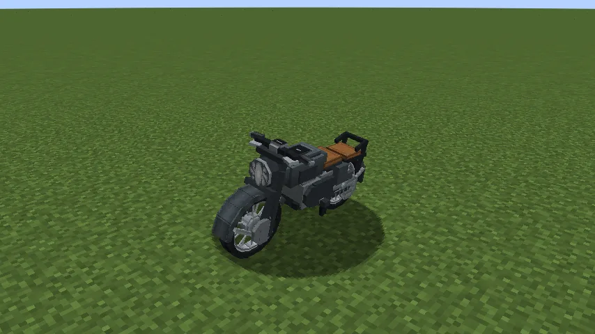
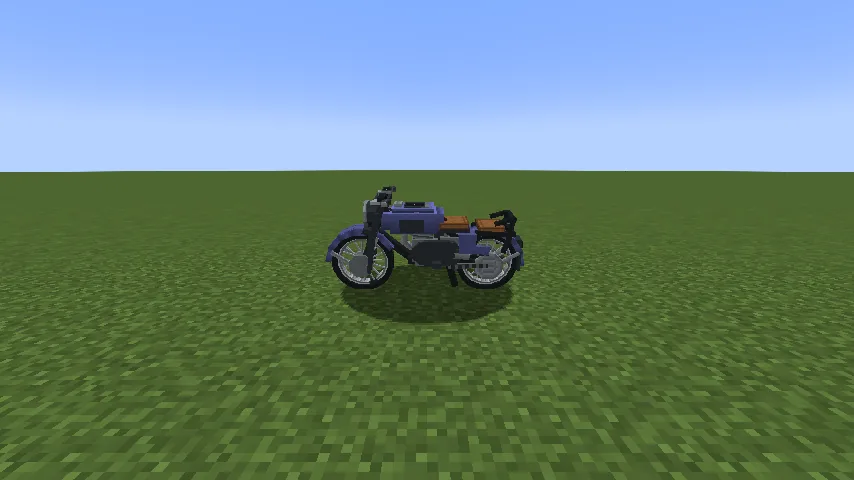
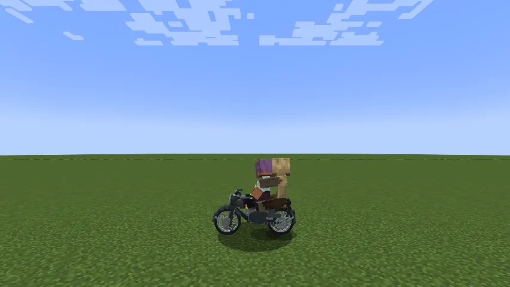
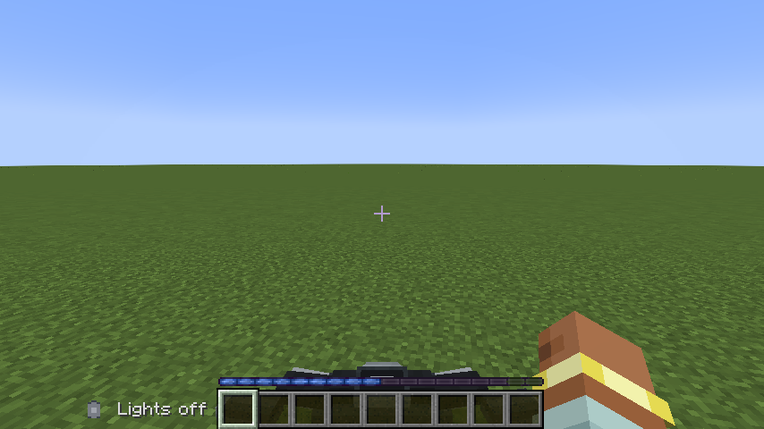
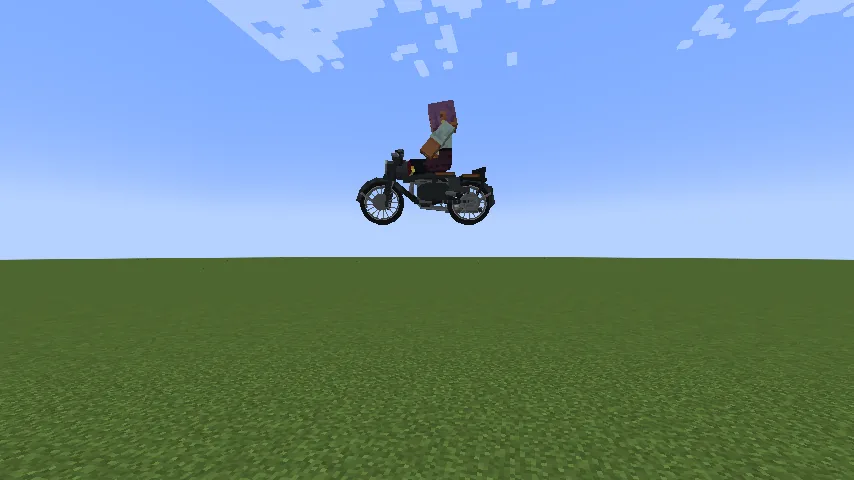
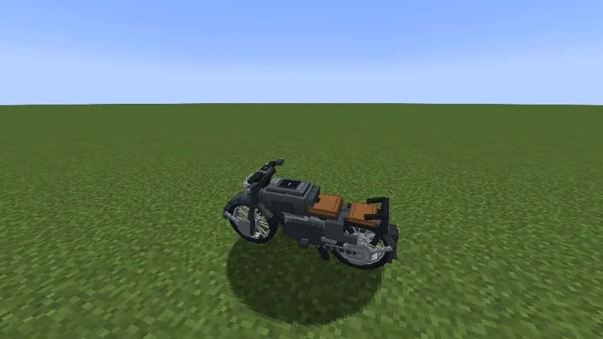
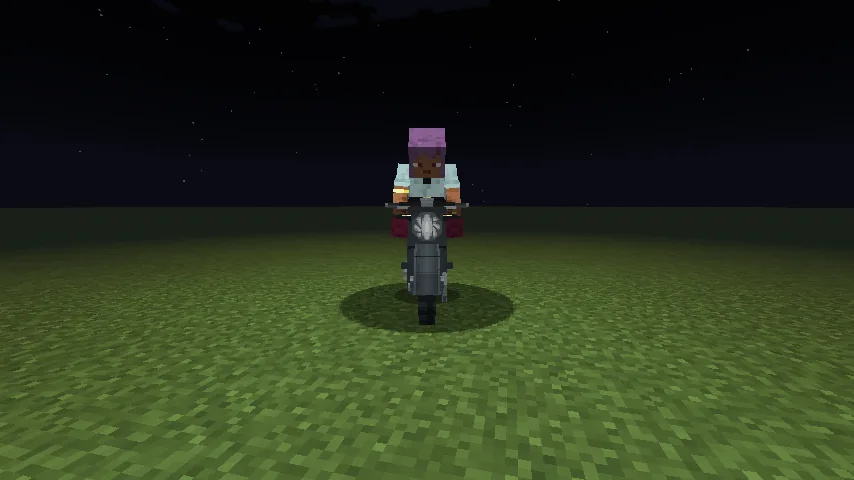

The **Iron Horse** is a vintage motorcycle. It seats two, the second on the pillion behind the
saddle; it has a headlamp, a kickstand it leans on when parked, it leans into its turns, and it
**jumps the way a horse does**. Everything else about riding it (fuel, keys, lights, packing it up,
repairs) is [Vanilla Wheels](/wiki/vanilla-wheels)'s, so read that page too.

## Getting one

1. **The chassis:** five steel ingots and a piece of leather: leather and steel side by side in the
   top row's right two slots, a row of three steel across the middle, and steel in each bottom corner.
   Steel comes from [Metals and Materials](/wiki/metals-and-materials).
2. **The parts:** **two wheels** and an **engine** (recipes on the
   [Vanilla Wheels](/wiki/vanilla-wheels#building-the-mechanic-lift) page).
3. **Build it** on a **Mechanic Lift**: chassis, wheels and engine in its slots, then **Build**. Put a
   dye in the lift and press **Paint**: the tank and fenders take the colour.
4. **Fuel it:** hold right-click at it with a full gas can.

## Riding it

- **Right-click** to get on (the saddle first, then the pillion); **crouch** to get off.
- **Movement keys** ride. It leans into every turn, further the faster and tighter you go.
- **Jump:** hold **Space**. The **jump bar** fills where your experience bar was, as on a horse. Let
  go, and it jumps with what the bar held: a full bar (about half a second) takes it **three blocks
  up**, two aboard or one; a tap barely leaves the ground. Holding Space never drifts it.
- **Landing** never hurts either of you or the bike, even jumping off a three-block drop.
- **H** turns the headlamp on.
- Left standing, it leans onto its **kickstand**; ride it and the stand folds up.

## What it can do

| | |
|---|---|
| Top speed | 0.85 blocks a tick (17 m/s) |
| Jump | three blocks up at a full bar |
| Climbs | one-block steps; jump anything taller |
| Size | 2¾ blocks long, 1 wide; fits on either Mechanic Lift |
| Tank | three quarters of a truck's |

## Repairs

- **By hand:** right-click a damaged Iron Horse; it costs hunger, no materials.
- **On the Mechanic Lift:** a full repair costs **8 steel ingots**; a partial one less.

